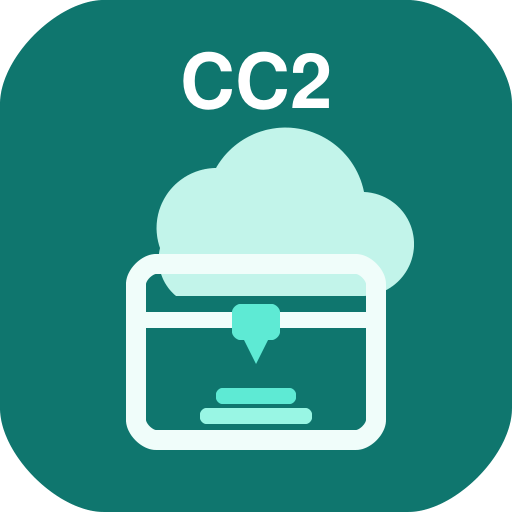

<p align="center">
  
</p>

<h1 align="center">Elegoo CC2 Cloud</h1>

<p align="center">
  <b>OrcaSlicer plugin for the Elegoo Centauri Carbon 2, over the Elegoo cloud.</b><br>
  Print from OrcaSlicer's own Print button, control the printer and watch the camera from OrcaSlicer 2.5.x, without ElegooSlicer.
</p>

<p align="center">
  
  
  
  
  
  
</p>

---

## Features

| | |
|---|---|
| **Print from Orca** | Slice and press Orca's normal *Print* button. A small local bridge answers as an Elegoo Link printer, the plugin uploads the file to the Elegoo cloud, the printer downloads it and the print **starts by itself** (filament slots matched by filament type; switch off with *Start after Orca upload*) |
| **Send G-code** | A button in the tab: pick a `.gcode` or `.gcode.3mf` with the Windows file dialog and upload it to the printer, then start it from *Printer files* |
| **Control tab** | Print (pause, resume, stop, speed), temperatures, motion with homing, fans, light, Canvas filament load and unload, files, print history |
| **Camera** | Live view from the printer. It starts by itself when the printer connects (switch off with *Auto-start*), and the picture can be resized or shown full screen |
| **Layout** | Two balanced columns (Print, Motion with a big X / Y / Z read-out, Console | Temperature and Fans with their graphs), then Camera, Filament and Files full width; one column on narrow windows |
| **Live status** | Progress, layers, temperatures, remaining time and the machine state, in the tab and in Orca |
| **Multi-colour** | Filament slots come from Orca's mapping and are sent as the printer's `slot_map`; files started from the tab get a slot picker per colour |
| **Auto-refresh** | Filament slots, files and history refresh after connecting, when a print ends, when the printer goes idle and every minute |
| **Graphs** | Temperatures (with targets) next to the temperature controls and the three fans next to the fan controls, recorded while connected; 5 min, 30 min or 2 h, with a hover read-out |
| **Command console** | Every command sent to the printer, from the tab or from Orca (motion, temperatures, fans, light, speed, filament, uploads, prints), with the result and how long it took |
| **Paging** | Files and print history have page buttons and a page size |
| **Stays connected** | A watchdog reconnects the cloud link when it drops while the tab is open, and Orca's disconnect calls no longer tear it down |
| **Own sign-in** | Signs in with Elegoo's own page in your browser; the session is stored encrypted (Windows DPAPI) and survives plugin reinstalls |
| **Themes** | *Simple dark* (default), *Simple white* and *0xpraet0rian* (navy and orange); the choice is saved |
| **No dependencies** | One Python file and the standard library; everything native goes through `ctypes` |

## Status

An early, personal-use build, developed against one printer. What is known:

| Area | State |
|---|---|
| Cloud HTTP: device list, Agora tokens, upload URL and upload | verified live |
| Commands over RTM: `1001`, `1002`, `1044`, `1057`, `1047`, `2005` | verified live |
| Camera: joining the RTC channel and playing the video | verified live (in a browser and from the tab) |
| Sign-in through the local pass-through, session capture and auto-connect | verified in Orca |
| Status and controls in the tab | live values shown; a temperature target and axis movement were seen taking effect |
| *Print* from Orca through the local Elegoo Link bridge (upload, printer download, start command) | verified from Orca: the console showed upload, download and a successful start; slot matching with several colours not verified |
| Light, fans, speed, filament load and unload, auto refill | parameters copied from ElegooSlicer's own page, **not verified on the printer** |
| Files and print history over the cloud API | endpoints taken from the public SDK, **not verified on the printer** |
| Pause state | read from the status table of the SDK; never seen on a real print |
| Filament slot decoding from `ams_mapping` | a guess (`canvas * 4 + tray`), logged on the first run |
| Files of 500 MB or more | not implemented |
| LAN mode | not supported |
| Orca's *Print plate* path (filament dialog) for a non-Bambu printer | not possible in stock Orca; see *How it works* |

## Install

1. In Orca: **Preferences → Developer → Experimental Features**, enable
   *Use printer agents instead of print hosts*.
2. **Plugins → Install local plugin**, choose
   [`plugin/elegoo_cc2_cloud_win_x86_64.py`](plugin/elegoo_cc2_cloud_win_x86_64.py) and accept the permission dialog.
3. In the CC2 printer preset set **Printer Agent** to *Elegoo CC2 (cloud)*.
4. Open the **Elegoo CC2** tab and press **Sign in with Elegoo**. The sign-in page opens in your browser.
   After signing in, the tab connects by itself (*Connect automatically*). Keep the tab open while you print.
5. To make Orca's *Print* button work, add a physical printer next to the printer name in the Printer panel:
   **Host Type** *Elegoo Link*, **Hostname** `127.0.0.1:47890`, API key empty or `123456`. *Test* should succeed.
6. Slice and press **Print**. The file is uploaded to the cloud and the print starts on the printer.

Notes:

- Orca requires the file name to end with the OS and architecture (`_win_x86_64`).
- **Close ElegooSlicer** while connected: the Elegoo account allows one cloud session at a time.
- Reinstalling a plugin makes Orca delete its folder. The session and settings are kept outside it, so you do not
  have to sign in again after an update.

## Using the tab

- **Account**: signed-in user, printer picker, *Connect via cloud*, *Log out*, and the exact reason when the
  connection fails (printer offline in the cloud, account used by another client, expired session).
- **Controls stay grey** until the printer has answered. Motion needs an idle printer with the axis homed.
- **Camera** card: *S / M / L / Fit / Full screen*, or drag the bottom-right corner of the picture.
- **Files**: *Print* opens a panel to map each colour of the file to a Canvas slot; *Delete* asks first.
- **Send G-code...** (Files toolbar) uploads a file you pick; **Start after Orca upload** controls the automatic start.
- **Theme** selector in the top right.

## Privacy and data

- **Sign-in**: the page is served to your browser through a loopback server on `127.0.0.1` started by the plugin, so
  your password passes through the plugin's memory on its way to Elegoo. It is never stored or logged. Only the
  session Elegoo returns is kept, encrypted with Windows DPAPI.
- **Where things are stored**: `<Orca data dir>/plugin_data/elegoo_cc2_cloud/` holds the encrypted session and the
  settings file.
- **Local bridge**: the plugin listens on `127.0.0.1:47890` (loopback only, requests with another Host header are refused)
  and accepts the two requests Orca's Elegoo Link host makes; nothing else is served.
- **What leaves the PC**: requests to the Elegoo cloud (`account.elegoo.com`, `matrix.elegoo.com`, its storage and
  Agora) and the two Agora SDKs loaded from `cdn.jsdelivr.net` when the tab opens.
- A separate *Use ElegooSlicer session* button can import the token of an installed ElegooSlicer instead (token
  only, read once).

## How it works

```
 OrcaSlicer 2.5.x
 ┌──────────────────────────────────────────────┐
 │ Printer Agent (Python)                       │──HTTPS──▶ matrix.elegoo.com   account, lists, tokens
 │   upload · status · commands · account       │──HTTPS──▶ Elegoo cloud storage (gcode upload)
 │                                              │
 │ "Elegoo CC2" tab (HTML + JS)                 │
 │   Agora RTM  ◀── bridge ──▶ commands, status │──RTM────▶ Elegoo cloud ──▶ Centauri Carbon 2
 │   Agora RTC  ── camera video ────────────────│──RTC────▶ (printer camera)
 └──────────────────────────────────────────────┘
     your browser ◀── 127.0.0.1 pass-through ──▶ Elegoo sign-in page

 Print button ─▶ Elegoo Link host ─▶ 127.0.0.1:47890 (plugin bridge) ─▶ cloud upload ─▶ printer downloads ─▶ start
```

Why a bridge: for a CC2, Orca's built-in *Elegoo Link* host only uploads over plain HTTP (`GET /system/info`,
chunked `PUT /upload`) and never sends a start command. Orca decides that in its own code, and for a non-Bambu
printer the *Print plate* path that would reach a printer agent cannot be selected from a preset. So the plugin plays
the printer on the loopback, sends the file to the cloud itself and then issues the start (`1020`) with the slot map.

The cloud only accepts commands over Agora RTM and has no Python client, so the plugin runs the Agora web SDKs in
an Orca page and passes JSON to and from Python. Orca's audit hook does not cover `ctypes`, and its message
bridge ignores the Elegoo sign-in page's messages, hence the Windows HTTP and socket code. Details and the message
tables are in [docs/PROTOCOL.md](docs/PROTOCOL.md).

## Known limits

- One cloud session per account: ElegooSlicer and this plugin cannot be connected together.
- The Agora SDKs load from a CDN without an integrity hash.
- Print history shows the raw status code reported by the printer; its meaning is not documented anywhere I found.
- The first chunk of a Print waits for the whole cloud transfer (about two minutes for 5 MB), so Orca sits at 99% for a while.
- Orca's plugin API is new and its printer-agent support is marked work in progress.
- Windows only (DPAPI, WinHTTP and Winsock through `ctypes`).

## Repository layout

```
assets/    icon (SVG, PNG, WebP, JPEG)
docs/      protocol notes
plugin/    the installable plugin
```

## Credits and disclaimer

The protocol was worked out from the public [`elegoo-link`](https://github.com/elegooofficial/elegoo-link) sources
(Apache-2.0), the OrcaSlicer plugin documentation, and logs and traffic from the author's own printer and slicer.
Plugin by [0xpraet0rian](https://0xpraet0rian.github.io/). Personal project, not affiliated with or endorsed by
Elegoo or the OrcaSlicer project. Use at your own risk: it can start prints, move axes and heat the printer.
